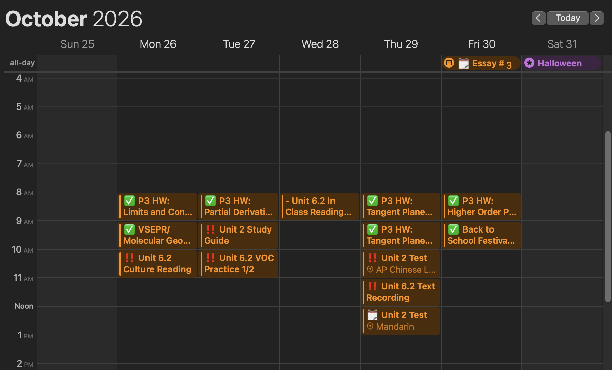

# schoology-ics

(Using Apple Calendar as the ical frontend)

### Features

A simple Flask server that organizes your Schoology calendar feed.
It stacks events and assignments per day, producing an organized list of
assignments and events per day on your calendar.

Additional features include:

- Schoology assignment submission checking
- Marking assignments as done
- Adding custom events and assignments

### Running

To run, clone the repository, import packages from the `uv` package manager using `uv sync` and run `main.py`.

On Mac, you can use `launch.sh` to run in the background, where it will remain
active until the computer is restarted.

On the first run, the program will ask you for your Schoology API key, API secret, user ID, and calendar link.

As an alternative, you can also provide environment variables `SCHOOLOGY_KEY`, `SCHOOLOGY_SECRET`,
`SCHOOLOGY_UID`, and `CALENDAR_URL` via either command line or a .env file located in the project directory.

Then, subscribe to `https://127.0.0.1:4588/fetch` (or the relevant IP address if you're not hosting locally) on your calendar app of choice.
